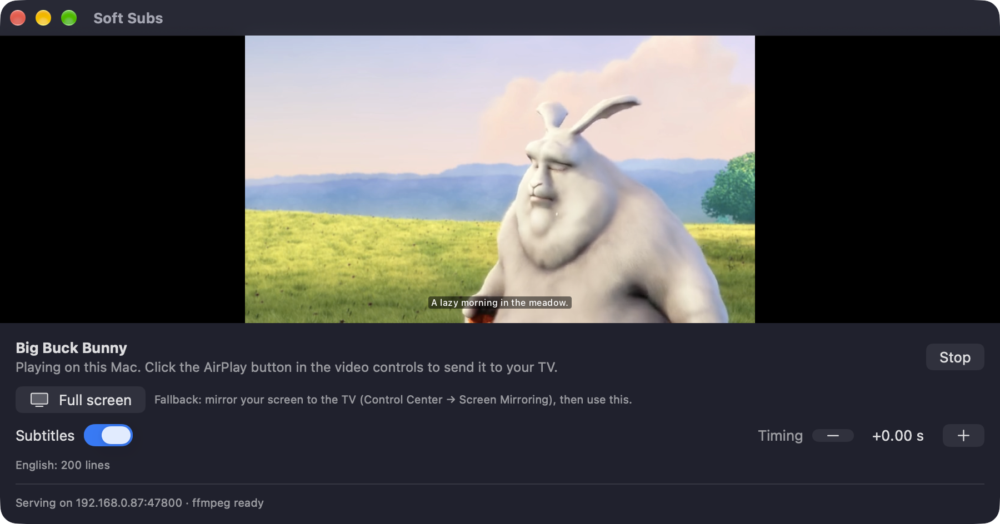

# Soft Subs AirPlay

AirPlay web videos from Safari to your TV, **with their subtitles**.

Normal AirPlay drops the subtitles on most sites. Soft Subs rebuilds the video stream with the subtitles inside it, so your TV shows them as real, toggleable subtitles.



## Quick setup

```bash
curl -fsSL https://raw.githubusercontent.com/KeiviX/soft-subs-airplay/main/install.sh | bash
```

This downloads the latest release (or builds from source if there isn't one), installs **Soft Subs** to Applications, installs ffmpeg with Homebrew if it's available, and opens the app. Then:

1. In **Safari → Settings → Extensions**, turn on **Soft Subs AirPlay** and choose **Allow on every website**. The app shows an **Open Safari Settings** button until you do.
   Not listed? Go to **Settings → Advanced → Show features for web developers**, then turn on **Develop → Allow Unsigned Extensions**. Safari turns this off again whenever it quits.
2. Play a video with subtitles on, click the **Soft Subs** toolbar button, then **Send to TV**.
3. In the Soft Subs window, click the **AirPlay button in the video controls** and pick your TV.

Installer options: `… | bash -s -- --source` builds from source; `--no-ffmpeg` skips ffmpeg.

<details>
<summary>Manual install</summary>

1. Download **SoftSubs-x.y.z.zip** from [Releases](../../releases), unzip it, and move **Soft Subs** to Applications.
2. Open it. If macOS says it can't verify the developer, go to **System Settings → Privacy & Security → Open Anyway** (only needed once).
3. Enable the Safari extension as described above.
4. Optional: `brew install ffmpeg`.

</details>

## Requirements

| | |
|---|---|
| macOS | 15 Sequoia or later, Apple silicon or Intel |
| Browser | Safari (Chrome support is planned) |
| TV | An AirPlay receiver: Apple TV, or an AirPlay 2 TV (Samsung, LG, Sony, Vizio…) on the same network as the Mac |
| ffmpeg | Optional but recommended (`brew install ffmpeg`). Needed for MP4/DASH sources and for exact subtitle timing on HLS |
| Building from source | Xcode 16+ and [XcodeGen](https://github.com/yonaskolb/XcodeGen) (`brew install xcodegen`) |

## Using it

- **Choosing subtitles.** The popup lists every subtitle source it found:
  - `<track>` files on the page and text-track cues the player has loaded
  - subtitle files the page downloaded (VTT, SRT, TTML/DFXP)
  - *Stream's own subtitles*, for HLS streams that already carry them
- **Subtitles on/off and timing.** Use the **Subtitles** switch in the app. If they're out of sync, nudge them in 0.25 s steps with **Timing −/+**.
- **If your TV only shows the picture with screen mirroring.** Mirror to it (Control Center → Screen Mirroring), ideally as a separate display, then click **Full screen** / **Show on <TV>**. Esc closes it.
- **Keep the app open while you watch.** It's what streams the video to your TV.

## How it works

When Safari AirPlays a `<video>`, it doesn't send what's on screen. It hands the TV the **media URL**, and the TV fetches the stream itself. So only subtitles *inside* the stream (an HLS `#EXT-X-MEDIA TYPE=SUBTITLES` rendition) reach the TV. Most sites instead add subtitles in the page, as `<track>` files, JavaScript cues or HTML overlays, or they play through Media Source Extensions (`blob:` URLs), which can't be AirPlayed at all.

```
Safari extension ──(stream URL, subtitle cues, Referer/cookies)──▶ Soft Subs.app (127.0.0.1:47800)
                                                                    │ local HTTP server on your LAN
                                                                    │ • rewrites the HLS master playlist to
                                                                    │   add a DEFAULT WebVTT subtitle rendition
                                                                    │ • proxies every playlist/segment/key with
                                                                    │   the page's headers (the TV has no cookies)
                                                                    │ • MP4/DASH → repackaged to HLS by ffmpeg (no re-encode)
                                                                    ▼
                                                     AVPlayer (AirPlay button in its controls) ──▶ TV
```

**Timing:** the browser's `currentTime = 0` is the stream's first presentation timestamp, which is often 10 s for TS streams. The app measures that timestamp with `ffprobe` and writes it into each WebVTT segment's `X-TIMESTAMP-MAP`, so cues line up.

**Awkward hosts:** the app sends an origin-only Referer (what Safari sends cross-site), relabels MPEG-TS segments disguised as `.jpg`/`.html`, and caches the master playlist, since signed URLs expire quickly.

**Troubleshooting:** the app logs every request to `~/Library/Logs/SoftSubs/soft-subs.log`, including which device asked (Mac or TV) and what the video host answered. `last-cast.json` in the same folder holds the last cast request, including that site's cookies, and `scripts/replay-last-cast.sh` re-sends it.

## Limits

- **DRM services** (Netflix, Disney+, Prime Video, Max, Apple TV+) can't work this way. The stream is encrypted and tied to the browser's license. Use their TV apps instead.
- Some hosts with strict hotlink protection or very short-lived URLs may still refuse.
- Live streams are proxied, but the subtitle track is built as video-on-demand.
- MP4/DASH sources are fully repackaged before playback starts. VP9/Opus (WebM) won't play on most TVs without transcoding.
- "Partial" text tracks: players like hls.js load subtitle cues as playback moves forward. For those, pick *Stream's own subtitles*.

## Development

```bash
brew install xcodegen ffmpeg
./build.sh --run              # generate the Xcode project, build into build/, launch
scripts/smoke-test.sh         # cast Apple's sample stream with test cues and print the rebuilt playlists
```

`build.sh` signs with your Apple Development certificate if you have one, otherwise ad-hoc.

| Path | What |
|---|---|
| `App/` | Helper app: `HTTPServer`, `StreamService` (proxy + routes), `Playlist` (HLS rewriting), `WebVTT`, `Media` (ffmpeg/ffprobe, LAN address), `CastController` (AVPlayer + API), `TVOutput` (full-screen fallback) |
| `Extension/Resources/` | Safari Web Extension (MV3): `page-hook.js` (fetch/XHR capture in the page world), `content.js`, `subtitles.js` (parsers), popup |
| `project.yml` | XcodeGen spec |
| `install.sh` | One-line installer |
| `scripts/release.sh` | Builds, zips and publishes a GitHub release |

### Releasing

```bash
scripts/release.sh 0.2.0 --dry-run   # build + zip into dist/
scripts/release.sh 0.2.0             # also bumps versions, tags v0.2.0 and publishes a GitHub release
```

With a **Developer ID Application** certificate in your keychain (paid Apple Developer Program), releases are signed with it. Setting `NOTARY_PROFILE` to a `xcrun notarytool store-credentials` profile also notarizes them. That removes the "Open Anyway" and "Allow Unsigned Extensions" steps for everyone else.

## Roadmap

- Built into the Keivi browser (WKWebView), with no extension sandbox
- Chrome support (the extension already talks to the app over localhost)
- Record subtitles that are drawn as HTML over the video
- Burn-in fallback for TVs that ignore soft subtitles
